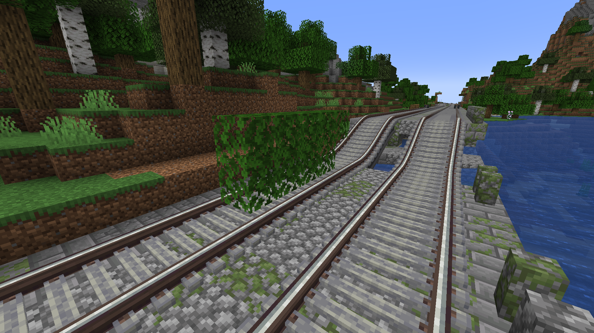
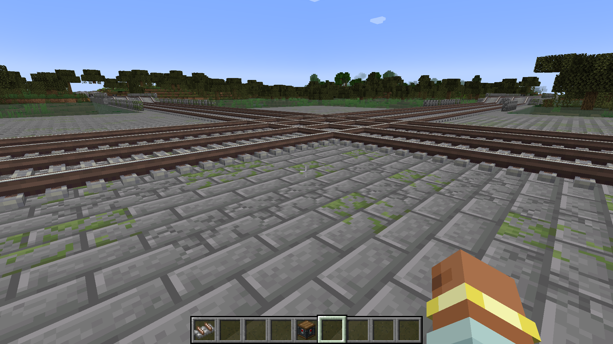
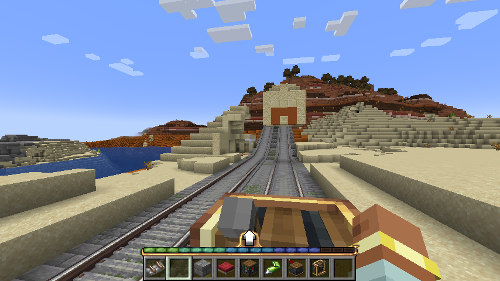

# Iron Roads

An endless railway network for Minecraft 1.21.1 (NeoForge), built out of
[Create](https://www.curseforge.com/minecraft/mc-mods/create) tracks. Worldgen lays a
continuous double-track main line grid across the overworld — with embankments, cuttings,
tunnels, viaducts, junctions, branch lines to villages and station platforms — and registers
it in Create's track graph, so a train can actually drive on it.



## What it generates

- **A grid of main lines**, 1536 blocks apart, running north–south and east–west. Every line
  is double track with ballast, sleepers, verges and lineside signals.
- **Smooth gradients and curves.** Create's `BezierConnection` handles every change of height
  or direction; there are no 45° slope blocks and no diagonal track blocks (both were tried
  in game and look wrong — see `docs/superpowers/plans/2026-07-25-railway-bezier-slopes.md`).
- **Earthworks that follow the terrain**: embankments with wing walls over dips, cuttings
  through low ridges, pillared viaducts across water and valleys, and lined tunnels with
  portals through anything too tall to cut.
- **Level junctions** at every grid node, where two lines cross on the same plane at the same
  height.
- **Branch lines to villages**, with a turnout off the main line and a lit platform with a
  named sign at the end. Village positions come from the world's own structure set, not from
  a hardcoded table, so datapacks and worldgen mods that move villages are followed.
- **Route deviation.** Lines wander laterally within a ±56 block corridor: partly for looks,
  partly to steer around mountains, and always to avoid driving straight through a structure.
  Obstacles are read from every rare structure set in the registry, so modded structures are
  avoided too, with no mod named anywhere in the code.
- **A right of way** that keeps forest off the track. The feature runs at the `fluid_springs`
  decoration step, before vegetation, and paves the corridor in gravel and stone — vanilla and
  modded saplings both refuse to spawn there, because they check the same `BlockTags.DIRT`
  predicate. Trees that grow outside the corridor and lean into the loading gauge get felled
  on chunk load.

| Junction | Tunnel portal |
|---|---|
|  |  |

Everything is deterministic: the same seed and coordinates always produce the same railway,
regardless of the order chunks generate in. Geometry is derived from splitmix64 hashes of
position, never from a seeded `Random`.

## Requirements

- Minecraft 1.21.1
- NeoForge 21.1+
- [Create 6.0+](https://www.curseforge.com/minecraft/mc-mods/create) — a hard dependency, not
  bundled. Create is the only supported loader/version combination for 1.21.1: there is no
  Forge build of Create for this version.

Terrain generators such as Terralith or Tectonic work without patches — the mod never names a
biome, a generator or a sea level, and reads terrain only through `ChunkGenerator` and vanilla
biome tags.

## Install

Drop the jar from `build/libs/` into `mods/` alongside Create. Use a **new world**: existing
saves keep the chunks they already generated, so the network will only appear in fresh terrain.

## Build

```
./gradlew build          # jar in build/libs/
./gradlew test           # geometry unit tests, no Minecraft needed
./gradlew runClient      # dev client
```

On Windows use `gradlew.bat`. The first run decompiles Minecraft and takes 5–15 minutes.

## How it works

Two passes, because `Feature.place()` may not touch neighbouring chunks — doing so triggers
cascading generation and deadlocks:

1. `worldgen/RailwayFeature` writes blocks inside its own 16×16 only, leaving gaps where curves
   will go.
2. `graph/RailwayGraphLinker` runs on chunk load, queued and drained a few chunks per tick, and
   fills in what needs neighbours: Bézier curves, track registration, gauge sweeping, furniture.

The `geometry` package is pure math with no Minecraft imports at all, reaching the world only
through a `HeightSampler` interface — which is why the routing, profile and clearance logic is
covered by plain JUnit tests.

One mixin (`mixin/TrackPropagatorMixin`) is required: Create's `TrackPropagator` walks connected
track through `Level.getBlockState`, which synchronously generates unloaded chunks on the server
thread. On a continuous 768-block main line that produced 120-second ticks. The mixin swaps the
level for one that answers "air" outside loaded chunks.

Design notes and the reasoning behind each decision (including the rejected alternatives) live in
`docs/superpowers/`, in Russian.

## Status

Early but playable — version 0.1.0. The network generates, connects and carries trains. Rough
edges: no config file yet, no custom blocks or textures (everything is vanilla and Create
blocks), and the overworld only.

## License

MIT.
